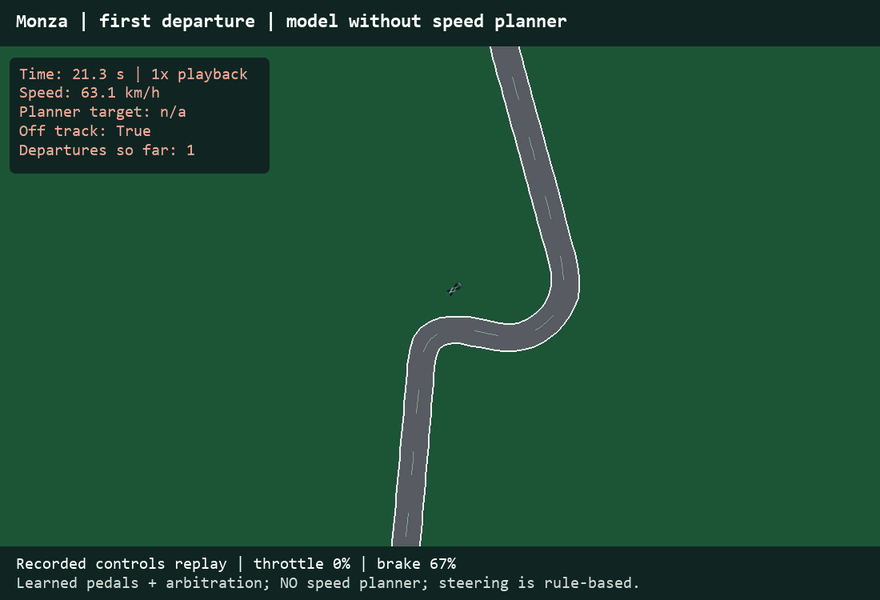
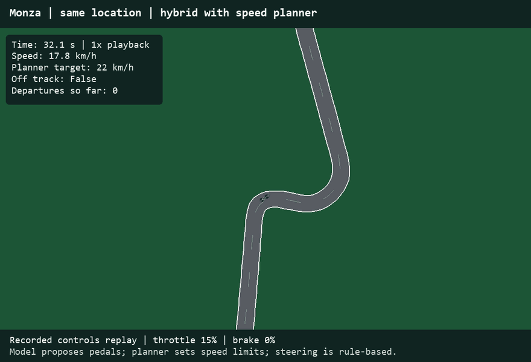
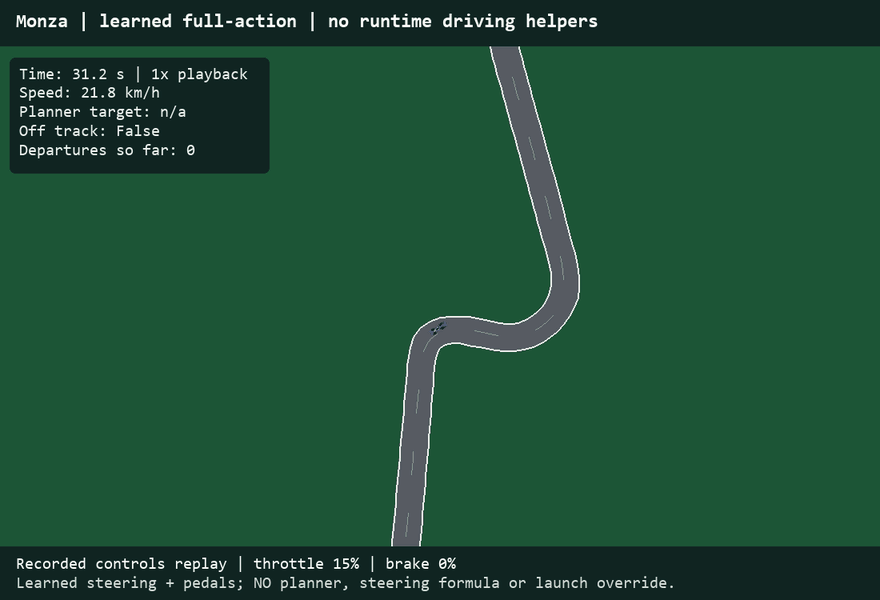

# F1 Racing Simulator: What We Built and Learned

Project documentation for INSY 674

Repository: https://github.com/amani-1110/INSY-674-Project

## Three Driving Stages

### 1. Without speed assistance



Original learned pedals; hand-written steering, pedal cleanup and launch handling remain.

**Monza: 91.8 s; INVALID, 13 departures. Silverstone: 600 s timeout, 5 departures. Spa: 600 s timeout, 9 departures.** See the expanded [24-attempt benchmark](output/all_configurations/REPORT.md).

### 2. With assistance



Original learned pedals plus hand-written steering and a speed planner that can override pedals.

**Monza: 205.4 s; VALID, 0 departures. Silverstone: 256.5 s; VALID, 0 departures.**

### 3. Learned steering and pedals



New models imitate a simulated teacher. No runtime driving assistance; actuator limits remain.

**Monza: 209.1 s; VALID, 0 departures. Silverstone: 266.3 s; VALID, 0 departures.**

A valid lap must finish with zero departures. All card results use 0.1-second steps. Clips are independent replays near the same Monza turn, not a synchronized race. Stage 3 uses different training examples and models.

## Frame the Problem and Look at the Big Picture

Can a computer learn to drive around a racing circuit and complete a clean lap on a circuit excluded from its training? We built a 2D simulator to investigate this question. The intended users are students and researchers who want to compare driving approaches in an environment where the decisions and results can be inspected.

Our first goal is a completed lap without leaving the road. Only then does a faster time count as an improvement. We report completion, road departures and elapsed time separately. These are simulator results, not official Formula 1 lap times.

The project began with real driver recordings: the computer learned the relationship between the road ahead, the car's situation and the driver's pedals. This is supervised learning: learning from examples with known answers. Later, we trained a separate driver to copy a simulated teacher's steering and pedal decisions. Neither approach is reinforcement learning.

The original team brief described the planned components and their interfaces. This document describes the implemented experiments; illustrative numbers and assignments in that brief are not treated as measured results.

## Explore the Data

We used 1,774 saved samples from Max Verstappen's 2025 Monza qualifying laps 5, 11 and 14. Each sample records time, position, speed, throttle and a brake-on indicator. The saved cleaned tables have no missing values. This does not mean that the original measurements were complete or free of noise: channels were synchronized and interpolated, and saved-export policies allow native gaps up to 1.3 seconds.

Time is measured in seconds, position in metres and speed in metres per second. Throttle ranges from 0 to 1. Brake is an on/off label, not a measurement of brake pressure. Measured steering angles are unavailable. The model predicts throttle and brake; it does not learn steering from these recordings.

The slowest saved speed is 73 km/h, but the simulator starts from rest. The examples therefore do not teach the original model how to launch or recover from every mistake. Braking appears in about 13 percent of samples, so always predicting no braking would already be correct about 87 percent of the time. Accuracy alone would give a misleading impression.

We also describe the car relative to the road: its distance along the lap, distance from the centre and difference between its direction and the road's direction. Future road bend measurements describe the shape ahead. Lap identity is used to keep training and evaluation separate, rather than as a driving input.

The distributions show that the examples mostly cover fast qualifying driving. Training-only correlations show relationships among nearby road-bend measurements, so these inputs overlap in what they describe. The saved Random Forest assigns its largest importance to the bend 40 metres ahead, about 29 percent. This describes how that fitted model uses its inputs; it does not prove a causal relationship. Additional sessions, circuits and low-speed recovery examples would address important coverage gaps.

The complete attribute-by-attribute profile, including ranges, variability and missing percentages, is saved in output/analysis_pack/attribute_profile.csv.

## Prepare the Data

The circuit maps and driver recordings use different coordinate systems. We fitted a position transformation using training lap 5, then reused it for the other laps from the same session. We checked the resulting paths against the circuit and converted positions into road-relative measurements. The preparation pipeline checks units and increasing timestamps, keeps lap identities and calculates the road shape ahead, including around the end of a lap.

Laps 5 and 11 provide 1,181 training samples. Lap 14, with 593 samples, was excluded from fitting the original saved models. To compare candidates, we trained on one whole training lap and checked on the other, then swapped them. This is two-fold grouped cross-validation. We did not randomly mix neighbouring samples between training and checking, because nearly identical nearby moments would make performance look better than it is.

Models that need inputs on comparable scales use standardization fitted only within each training fold. Random Forest does not require this scaling. Inputs include speed, position relative to the road, direction error and future road bends; pedal outputs are bounded between 0 and 1.

Lap 14 was later inspected repeatedly during development. Its scores should now be called exploratory validation, rather than a fresh final test. Silverstone was evaluated with frozen Monza-trained weights, but future changes should be evaluated on another untouched circuit or session.

## Measure and Compare Their Performance

We first asked how closely predictions match the recorded pedals. Mean absolute error (MAE) is the average size of a prediction mistake. On a 0-to-1 pedal scale, an error of 0.0616 means about 6.16 percentage points, not 93.84 percent classification accuracy.

The table below reports average error plus or minus the sample standard deviation across two whole-lap folds. Two folds provide limited evidence. Random Forest and the support-vector model are very close; the small difference does not establish a decisive winner.

We provisionally shortlisted Random Forest because it is the working nonlinear baseline, the support-vector model because its errors are comparable using a different approach, and the neural network as another nonlinear candidate. The linear model remains a simple reference. These models were screened using specified initial settings, rather than a completed tuning search.

We then asked whether good predictions produce good driving. Early models given road previews of 20, 250 and 500 metres completed laps with departures; the 1,000-metre version timed out after 600 seconds. A stopped car with no departures is not a successful lap. We found conflicting partial throttle and brake outputs and a mismatch between qualifying-speed training examples and a standing start. Pedal cleanup and a launch rule addressed those immediate issues, but did not supply safe corner speeds.

The three-stage comparison at the start of this document shows the next steps. Stage 1 still uses hand-written steering, launch handling and exclusive pedals. Stage 2 adds a speed planner that can override learned pedal proposals. It completes cleanly, but its reliability belongs to the complete assisted system.

To isolate the original pedal model's contribution, we compared stage 2 with the same system without learned pedal suggestions. The planner-only driver took 208.7 seconds at Monza and 258.3 seconds at Silverstone; the assisted learned-pedal driver took 205.4 and 256.5 seconds. All four laps had zero departures. These are small benefits under matched deterministic conditions, not statistical evidence of broad superiority.

| Model | Throttle MAE (mean +/- SD) | Brake MAE (mean +/- SD) |
|---|---:|---:|
| Mean baseline | 0.3015 +/- 0.0006 | 0.2243 +/- 0.0000 |
| Ridge regression | 0.2043 +/- 0.0058 | 0.2010 +/- 0.0003 |
| Random Forest | 0.0616 +/- 0.0035 | 0.0780 +/- 0.0026 |
| RBF support vector | 0.0617 +/- 0.0021 | 0.0791 +/- 0.0013 |
| Neural network | 0.0952 +/- 0.0013 | 0.0997 +/- 0.0005 |

## Fine-Tune the System

We explored longer road previews, pedal cleanup, standing-start handling and a conservative corner-speed planner. The planner uses the road's bends and braking distance to slow the car before corners. Its assumed limits are 4 metres per second squared of sideways acceleration, 5 metres per second squared of braking, a 15-metre buffer and a 45-metres-per-second speed cap. These are chosen simulator limits, not measured limits of a Formula 1 car.

For stage 3 we changed the training examples. A hand-written simulated teacher labelled 40,000 varied Monza car situations, including speeds from 0 to 50 metres per second and position/direction errors. A small neural network learned steering; an ExtraTrees model learned a signed pedal command, where positive means throttle and negative means brake. The steering network uses standardized inputs and two hidden layers of 32 units; the pedal model contains 100 trees.

This is expert imitation, also called behaviour cloning. The teacher supplies answers during training but does not drive during evaluation. The saved model completed Monza and Silverstone with no runtime speed planner, steering formula, launch override or teacher fallback. Actuator limits and conversion to separate throttle/brake commands remain. Evaluation guards were active to catch calls to the disabled helpers. No Silverstone states trained this policy, and no additional dataset-aggregation refit was needed.

The learned driver completed valid laps in 209.1 seconds at Monza and 266.3 seconds at Silverstone. It is slightly slower than stage 2, while making steering and pedal decisions through learned models. Stage 3 changes both the training data and the driver; the three cards are a development story, not an experiment changing assistance alone.

A Monza check using 0.05-second simulation steps produced 208.9 seconds and zero departures for stage 3. This checks sensitivity to timestep; it is not a repeated-trial reliability estimate.

The additional tuning, combined-model comparison and fresh-circuit evaluation are documented in the next section.

## Completed Tuning, Ensemble Comparison and Fresh Final Test

We completed a modest, reproducible search using only Monza laps 5 and 11. Six randomly sampled settings were checked for each of Random Forest, support-vector regression and the neural network (18 candidates, each checked on two whole-lap folds). The random seed was fixed at zero. The objective was the average of throttle and brake MAE, with predictions bounded to 0 to 1. Lap 14 and Silverstone did not choose these settings.

We varied tree minimum leaf size (2, 5, 10), maximum depth (16 or unrestricted) and feature fraction (0.7 or 1.0). For the support-vector model we varied C (0.5, 1, 5, 10), epsilon (0.02, 0.05, 0.1) and gamma (scale, 0.03, 0.1). For the network we varied hidden layers (32/16, 32/32, 64/32), regularization (0.0001, 0.01, 0.1) and learning rate (0.0003, 0.001). These choices vary model flexibility, smoothing and fitting. A limited search is appropriate given only two independent training laps. Scaling is fitted inside each fold.

We also tested an equal-weight combination of the tuned Random Forest and support-vector model. The weights were fixed in advance. Its two members are fitted separately for each target and fold. The following are selection scores, not independent final-test errors; reusing folds to choose settings makes the scores optimistic.

The selection-error table below reports mean plus or minus sample standard deviation across the two folds. 

Random Forest was selected using the lowest combined selection error. The ensemble did not improve its selection error, so combining models was not automatically beneficial for matching recorded pedals. No convergence warnings were recorded during the cross-validation fits. The selected tree settings were 200 trees, minimum leaf size 2, depth limit 16 and feature fraction 0.7.

Before retrieving Spa geometry or running it, we saved a final-test protocol, froze all four fitted candidate models and the existing full-action policy, and recorded their hashes. The protocol specifies a standing start, 0.1-second steps, a 600-second timeout and zero departures for a valid completed lap. Spa was not used for training or choosing model/planner settings. All predefined candidates are reported below; the primary comparison is the CV-selected Random Forest versus the planner-only reference. The original stage-3 learned policy is reported separately.

The final-test table below includes every predefined Spa result. The tuned pedal candidates all retain the same hand-written steering and speed planner; the frozen full-action driver is the separate stage-3 policy. 

The preselected Random Forest hybrid changes the valid time by 5.4 seconds relative to planner-only (positive means faster). The neural-network pedal candidate has larger recorded-pedal prediction errors than Random Forest, yet its Spa hybrid lap is faster. This reinforces the distinction between matching recorded pedals and driving well with a planner. We retain the model selected before the final test; choosing another model from Spa results would make Spa development data for that new choice.

All saved model hashes were unchanged after testing. No settings were revised after seeing Spa. This is a fresh closed-loop simulator evaluation, not an independent test of real-driver pedal prediction. It covers one deterministic starting condition and does not establish statistical significance or broad reliability. Additional sessions and more independent laps would strengthen future studies.

The original three cards remain historical measured configurations. The new tuning study does not retroactively change their models or lap times. Detailed settings, individual trials, fold errors, model hashes and final results are saved in output/completed_study. The complete workflow is implemented in complete_model_study.py; use --output output/completed_study_reproduction for reproductions so the original final-test record is preserved. Rerunning an already inspected Spa test is a reproduction, not another fresh test.

| Tuned candidate | Throttle MAE (mean +/- SD) | Brake MAE (mean +/- SD) |
|---|---:|---:|
| Random Forest | 0.0452 +/- 0.0036 | 0.0624 +/- 0.0013 |
| Support vector | 0.0511 +/- 0.0025 | 0.0689 +/- 0.0017 |
| Neural network | 0.0952 +/- 0.0013 | 0.0997 +/- 0.0005 |
| Equal RF and SVR ensemble | 0.0457 +/- 0.0012 | 0.0632 +/- 0.0017 |

| Spa driver | Elapsed time (s) | Departures | Valid completed lap |
|---|---:|---:|---|
| Planner only | 287.4 | 0 | Yes |
| Random Forest | 282.0 | 0 | Yes |
| Support vector | 281.9 | 0 | Yes |
| Neural network | 276.8 | 0 | Yes |
| Equal RF and SVR ensemble | 281.2 | 0 | Yes |
| Frozen full-action driver | 294.3 | 0 | Yes |

## Assumptions and Limitations

The car physics are approximate and not calibrated to the recorded Formula 1 car. Track maps are smoothed and their widths estimated, so alignment and road boundaries are uncertain. Road departures are judged using the simulated car's reference point, rather than official tyre and kerb rules.

The real recordings cover one driver, one session and one circuit. The final policy learns a simulated teacher's behaviour and limits. Its successful Silverstone run is useful transfer evidence under one predefined simulator condition, not proof of driving safely on arbitrary new circuits or in real vehicles. Future evaluation should vary starting conditions and report every predefined attempt, including failures.

The main lesson is that matching recorded pedals is different from completing a clean lap. Assistance made the original system reliable in the measured runs; new teacher-labelled examples then allowed a separate learned driver to complete clean laps without those driving rules at runtime.

## Project Structure and Reproduction

Repository: https://github.com/amani-1110/INSY-674-Project

The track module supplies road shape and boundaries. The physics module moves the car. The simulator joins them and tracks time, progress and departures. Telemetry extraction saves driver recordings; alignment matches those recordings to the road. The original imitation module learns pedals. The baseline, speed planner and evaluation modules supply reference drivers and comparable measurements. The full-policy module implements the later learned steering-and-pedals driver.

Evidence files: output/analysis_pack/manifest.json records replay sources, hashes and measured results; model_family_cv_summary.csv and model_family_cv_folds.csv contain the candidate comparison; output/learned_driver/training.json records the final training setup; the per-circuit benchmark.json files record final evaluation and helper guards. The analysis pack also contains distributions, correlations, feature importance and the attribute profile.

The following commands reproduce the main workflows from the repository root. Training and exports can replace generated files, so use a separate checkout if preserving existing artifacts is important.

```powershell
python -m pip install -r requirements.txt
python -m pytest -q
python run_pipeline.py --lookahead 500 --output output/pipeline_500m
python screen_model_families.py
python benchmark_speed_planner.py --horizon 500
python benchmark_planner_ablation.py --track monza --horizon 500
python benchmark_planner_ablation.py --track silverstone --horizon 500
python train_full_driver.py
python benchmark_learned_driver.py --track monza
python benchmark_learned_driver.py --track silverstone
python -m f1_simulator.demo --track monza --controller learned
```
