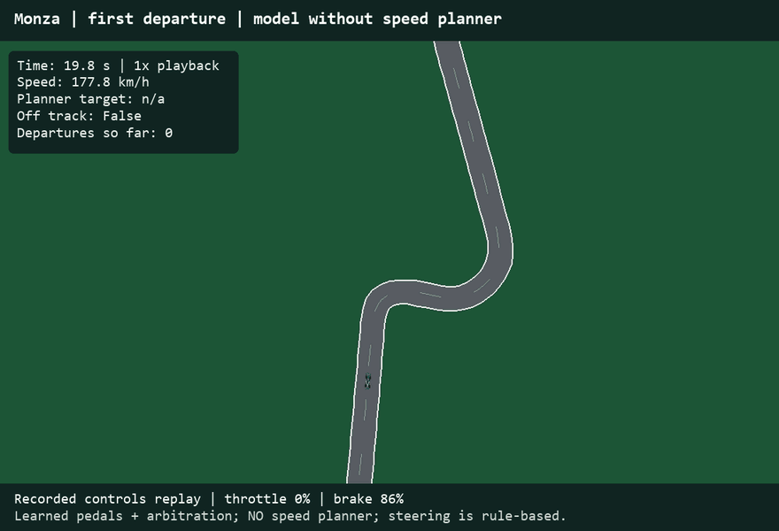
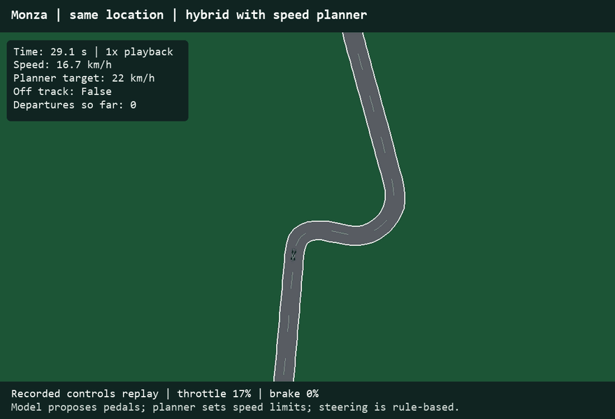
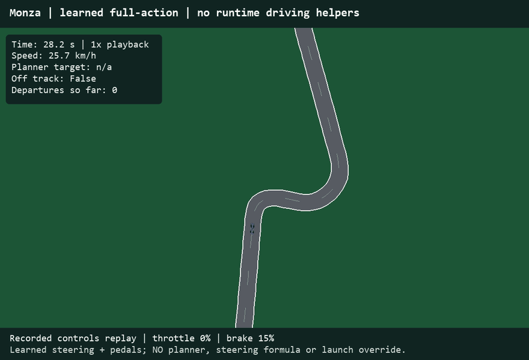

# Analysis: what the evidence supports and what remains

## Three stages of driving: assistance versus learned control

These are three system configurations, not a controlled ablation of assistance
alone. Stages 1/2 share the original pedal model; stage 3 uses a new full-action
policy and different training labels. Times are measured at 0.1 s simulation steps.

### 1. Without speed assistance

The original 500 m model proposes throttle and brake without the speed planner.
Rule-based steering, exclusive pedals and a launch rule remain active. This is
not fully unassisted AI driving.



**Track: Monza**  
**Completion time: 91.8 s - invalid (13 departures).**  
**Track: Silverstone - not tested in this configuration.**

### 2. With assistance

The original learned pedals are combined with hand-written steering, launch
handling and a curvature/braking speed planner. The planner can override pedals.



**Track: Monza**  
**Completion time: 205.4 s - valid (0 departures).**  
**Track: Silverstone**  
**Completion time: 256.5 s - valid (0 departures).**

### 3. AI-learned steering and pedals - no runtime driving assistance

**Implemented and tested.** A neural network predicts steering, and a learned
ExtraTrees regressor predicts a signed pedal command (positive throttle,
negative brake). The runtime has no corner-speed planner, steering formula,
launch override, target-speed tracker or teacher fallback. Only actuator-range
clipping and conversion of the signed command to throttle/brake remain.



**Track: Monza**  
**Completion time: 209.1 s - valid (0 departures).**  
**Track: Silverstone**  
**Completion time: 266.3 s - valid (0 departures).**

Training changed: 40,000 perturbed Monza simulator states were labelled by the
planner-only expert, including low-speed and recovery situations absent from
qualifying telemetry. Steering labels now exist because the teacher is simulated.
This is full-action expert imitation, **not reinforcement learning** or independent
discovery of corner-speed limits. The policy learns the teacher's behavior; the
teacher does not drive the car during inference. No Silverstone states were used
for training. Dataset-aggregation code is available if rollouts fail; this model
completed cleanly on its first fit, so no aggregation refit was performed.

The evaluator replaces planner, rule-steering and pedal-cleanup entry points
with functions that raise errors. Both learned-policy benchmarks completed with
these guards active and the saved model hash unchanged.

All clips are independent 1x recorded-control replays near the same Monza turn,
not synchronized races. A shorter invalid completion is not a valid improvement.
This is a limited deterministic simulator test, not proof of real-car driving.

Run the third stage:

```powershell
python -m f1_simulator.demo --track monza --controller learned
python -m f1_simulator.demo --track silverstone --controller learned
```


The numbered analysis below describes the original pedal-model experiments;
the full-action follow-up above is a separately trained policy.

## 1. Frame the problem

Research question: can learned longitudinal control reduce valid simulated lap
time beyond a shared rule-based planner and steering controller, including on a
circuit excluded from model training? The immediate users are the project team
and researchers comparing controllers in a transparent 2D environment. This is
offline supervised multi-output regression followed by closed-loop simulation,
not reinforcement learning and not a real-car autonomous-driving system.

Use three distinct measurements: pedal MAE for offline imitation, completion and
track departures for driving validity, and lap time only for valid completed
laps. A stopped car with zero departures is not a success. A fast completion
with departures is not a valid improvement. The application illustrates the
experiment; screenshots and GIFs do not replace quantitative evaluation.

## 2. Explore the data

There are 1,774 saved samples from Verstappen's 2025 Monza qualifying laps 5, 11
and 14: one driver, one session, one circuit. The smallest saved speed is 73 km/h,
whereas the simulator starts at rest. This is a concrete distribution mismatch.
About 13.0% of labels have the brake on, so an always-off classifier already has
roughly 87% accuracy. Report brake MAE and class-specific errors alongside
accuracy; high accuracy alone is weak evidence.

`attribute_profile.csv` profiles types, missing percentages, ranges, medians and
variability for every saved raw/aligned attribute. The cleaned CSVs contain no
missing values. This does not prove the upstream streams were complete or noise-free.

| Attributes | Meaning and distribution | Noise / usefulness |
|---|---|---|
| time | Continuous seconds; increases within each lap, restarts for the next | Timestamp alignment and gap checks matter; not a model input |
| x, y | Local continuous coordinates in metres | Approximate telemetry positions; transformed to the track frame; not model inputs |
| speed | Positive continuous m/s; concentrated at qualifying speeds | Interpolated sensor channel; model input with a launch/recovery mismatch |
| throttle | Bounded continuous target, 0-1; many near-full-throttle values | Public pedal label, not engine force; simulator response differs |
| brake | Binary target, 0/1; class-imbalanced | Not measured brake pressure; averaged regression can conflict with throttle |
| s | Periodic centreline station in metres | Derived projection; used for curvature engineering, not supplied directly as track identity |
| lateral_offset | Signed continuous metres; left positive | Racing line and estimated boundaries introduce uncertainty; model input |
| heading_error | Wrapped radians estimated from several positions | Derived from smoothed positions; sensitive to noise and sampling; model input |
| lap_id | Categorical grouping identifier | Keeps laps separate for splitting; excluded from model features |
| curvature ahead | 15 engineered stations through 500 m, inverse metres | Geometry-derived model inputs; nearby/far samples correlate; 18 scalar inputs including speed/offset/heading |

Figures 04-06 show distributions, training-only correlations and saved-model
importance. The top impurity-importance feature is curvature 40 m ahead
(about 29%). This is descriptive, not causal; correlated curvature samples can
share or exchange importance. Position-frame alignment and interpolated channels
limit the precision of all downstream interpretations.

## 3. Prepare data without adjacent-sample leakage

The pipeline converts units, validates monotone lap-relative time, retains lap
identity, transforms a substantial trajectory into the TUM frame, projects to
track-relative records, and engineers wrapped future curvature. The telemetry
metadata documents interpolation and source gap policies; the saved exports
allow up to 1.3 s native gaps and must not be described as uniformly measured
high-frequency data. The runtime extraction's older gap policy differs.

The initial training split uses laps 5 and 11 (1,181 samples), with lap 14
excluded from fitting the saved models. The shared alignment transform was fitted
on training lap 5. Random Forest requires no feature standardization. Ridge,
SVR and the neural network use StandardScaler fitted inside each CV training
fold, rather than on pooled training/validation data. All compared predictions
are clipped to the physical 0-1 label range before scoring.

**Important evaluation caveat:** lap 14 has now been inspected repeatedly while
exploring horizons. Call those measurements exploratory validation, not an
untouched final-test estimate. Silverstone was evaluated with frozen Monza model
weights and planner settings, but after seeing that result it must not be used
to tune a new system while still claiming a fresh test. Reserve a third circuit
and additional sessions for a future final evaluation.

## 4. Compare model families

A new exploratory screen compares a mean baseline, Ridge, Random Forest, RBF
support-vector regression and a small neural network. It uses only laps 5/11:
two-fold GroupKFold, with one entire lap held out in each fold. Neural/SVR/Ridge
scalers stay inside the folds. The existing deployed model was not replaced.

| Model | Throttle MAE: mean +/- SD | Brake MAE: mean +/- SD |
|---|---:|---:|
| Mean baseline | 0.3015 +/- 0.0006 | 0.2243 +/- 0.0000 |
| Ridge regression | 0.2043 +/- 0.0058 | 0.2010 +/- 0.0003 |
| Random Forest | 0.0616 +/- 0.0035 | 0.0780 +/- 0.0026 |
| RBF support vector | 0.0617 +/- 0.0021 | 0.0791 +/- 0.0013 |
| Neural network | 0.0952 +/- 0.0013 | 0.0997 +/- 0.0005 |

For interpretation, throttle MAE 0.0616 is about 6.16 percentage points on the
0-1 control scale; it is not a classification accuracy.

The error bars in Figure 08 are sample standard deviations across **two folds**,
not confidence intervals or estimates from many independent sessions. Random
Forest and SVR are close; their small mean difference is insufficient to claim
a decisive winner. The small neural network improves over linear/mean baselines
in this screen but has larger errors than those two candidates. No convergence
warnings were recorded for these fits.

Provisional shortlist: RF (current working multi-output baseline), SVR (comparable
CV error with a different function class), and the neural network (a distinct
nonlinear alternative worth tuning). Ridge remains an interpretable reference.
This is an initial screen with specified settings, not a completed tuning study.
`model_family_cv_folds.csv` provides per-fold scores and lap memberships.

## 5. Analyze driving errors and interventions

The original raw-pedal horizon experiments did not yield a valid lap: 20 m
completed in 86.2 s with 14 departures; 250 m in 91.6 s with 9; 500 m in 120.0 s
with 9; 1,000 m timed out after 600 s and travelled only about 883 m. The zero
departure count in the timeout is not evidence of successful driving.

We diagnosed simultaneous partial throttle/brake from the regression outputs and
the out-of-distribution standing start. Exclusive pedals and a launch rule fix
that immediate conflict, but do not learn a safe cornering policy. Historical
raw-pedal and corrected-pedal runs must not be mixed as a horizon-only comparison.

For the corrected 500 m model, completion was 91.8 s with 13 departures. The
planner-equipped hybrid completed in 205.4 s with zero. The failure GIF and
same-location hybrid GIF show this distinction. The failed clip uses the first
observed departure, not a manually chosen worst-looking event. Corner clips
use two largest geometry-curvature peaks separated by at least 500 m; station
labels are distances from the dataset start, not official corner numbers.

The hand-written planner sets corner speeds using a 4 m/s^2 lateral-acceleration
assumption, backward braking constraints, a 15 m buffer and a 45 m/s top-speed
cap. These conservative limits explain low corner speeds. Rule-based steering
is unchanged. Therefore, the clean lap demonstrates the hybrid system; it does
not prove that the AI learned the corner speeds independently.

## 6. Isolate the AI contribution and test transfer

| Circuit | Planner-only | Hybrid | Learned-pedal benefit | Departures |
|---|---:|---:|---:|---|
| Monza: training circuit | 208.7 s | 205.4 s | 3.3 s / 1.6% | 0 / 0 |
| Silverstone: unseen to trained model | 258.3 s | 256.5 s | 1.8 s / 0.7% | 0 / 0 |

These ablations use the same planner, steering, observation stations, start,
physics, timestep and pedal rules. The planner-only version never calls a trained
predictor. The Monza model weights and planner settings were frozen before the
Silverstone test, with model/source hashes retained. The planner is allowed to
query Silverstone geometry; no Silverstone driver telemetry is involved.

This supports a small transfer benefit from learned pedal proposals in these
deterministic simulator conditions. It does not establish broad generalization
or statistical significance. Do not claim superiority to real drivers. The
0.05 s Monza check (204.6 s, zero departures) is a useful timestep sensitivity
check, not a reliability guarantee.

## 7. Remaining work against the rubric

1. **More independent groups:** collect additional training laps/sessions to
   support more than two CV folds. Keep a new circuit/session untouched for a
   final evaluation. Never randomly split adjacent telemetry rows.
2. **Justified tuning:** use grouped training-only CV for a modest randomized
   search over the shortlisted models. Explain the search bounds and budget.
   Treat horizon and transformations as hyperparameters; do not optimize them
   using the final test circuit.
3. **Ensemble experiment:** compare a justified RF/SVR or other complementary
   combination with its individual members. RF is already a tree ensemble, but
   that does not replace the requested explicit comparison.
4. **Model/error interpretation:** add permutation-importance stability across
   groups, brake precision/recall or balanced metrics, error by speed/curvature,
   and more recovery-state examples. Impurity importance is a first pass.
5. **Closed-loop evaluation:** benchmark shortlisted/tuned candidates rather
   than assuming smaller offline MAE means faster valid laps. Evaluate multiple
   predefined starts/conditions without selecting only successful outcomes.
6. **Submission:** link the GitHub repository and organize documentation around
   the rubric's four source-code areas. Build the presentation with a clear
   problem-to-evidence storyline and rehearse to the stated 10-minute limit.

The media pack improves communication and documents real results. It does not
substitute for missing tuning, ensembles, independent data or final-test discipline.

## 8. Assumptions and their practical impact

- TUM tracks are smoothed from OpenStreetMap and estimated widths, not surveyed
  current layouts. Their local frames differ from telemetry; alignment is needed.
- The simulated vehicle is approximate and not calibrated to the recorded car.
  Its physics lacks a combined friction circle, tyre wear and car-specific dynamics.
- Road departures use the car's state/reference point, not full-body tyre/kerb
  rules. A simulated valid lap is not equivalent to an official F1 valid lap.
- Single-driver/single-session labels and interpolated controls limit generality.
- Standing starts/recovery states lie outside qualifying examples. Launch and
  speed limits are rules, not learned behavior.
- The planner supplies most of the driving reliability; learned pedals provide
  only the measured marginal benefit in the ablation.

## Reproduce the analysis pack

From the repository root:

```powershell
python screen_model_families.py
python export_analysis_pack.py
```

The export replays saved controls through the original simulator and asserts
that speeds, elapsed time, lap completion and departure counts match the saved
benchmark. `manifest.json` records trace hashes and clip selection/playback.
Full-lap GIFs use nominal 10x playback; corner/failure GIFs use 1x playback.
All visual samples are simulated recorded-action replays, not real onboard footage.
The model-family screen does not retrain or overwrite the driving models.


## Model screening settings (not tuned)

| Model | Initial settings | Why included |
|---|---|---|
| Mean baseline | Training-fold target means | Establishes a trivial prediction reference |
| Ridge | alpha=1; fold-fitted standardization | Simple regularized linear reference |
| Random Forest | 200 trees; min leaf=5; seed=0 | Current deployed family; nonlinear interactions |
| RBF SVR | C=1; epsilon=0.05; one regressor per target; fold scaling | Non-tree nonlinear alternative |
| Neural network | Hidden layers 32/16; max iterations=1000; seed=0; fold scaling | Small multilayer nonlinear alternative |

Source: user-provided INSY_674_Final_Project_Rubric (1).pdf, particularly the
source-code rubric on page 4 and presentation rubric on page 5. The copyrighted
rubric is referenced rather than included in this export.
